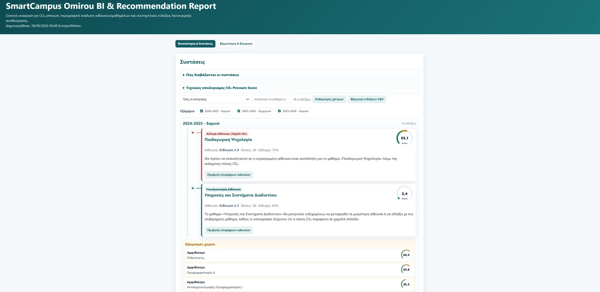
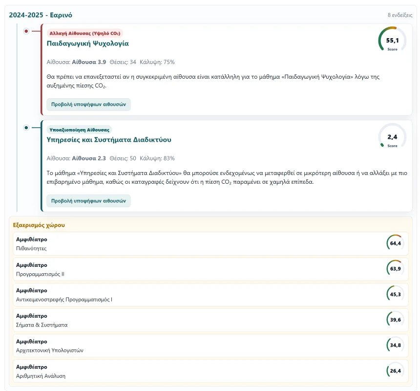
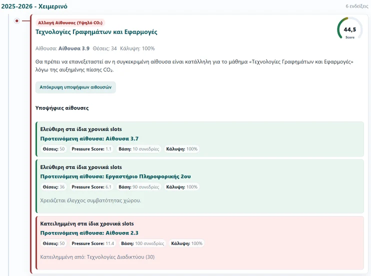
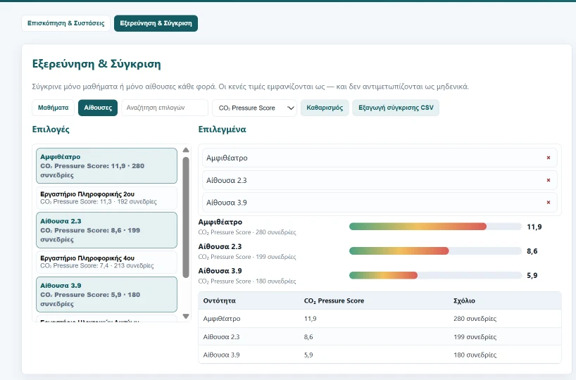
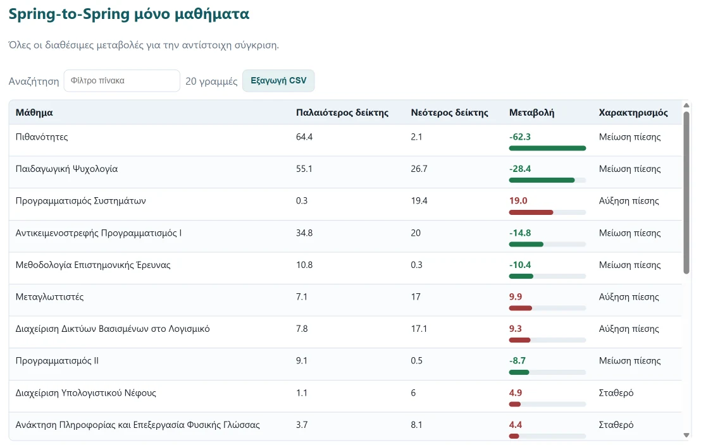
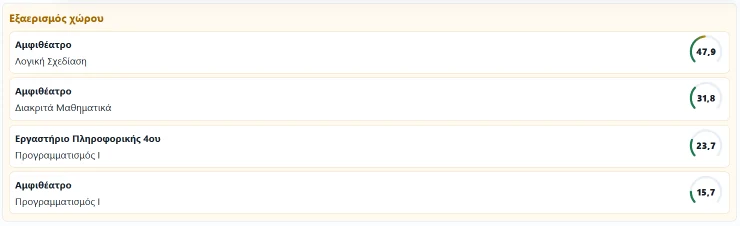
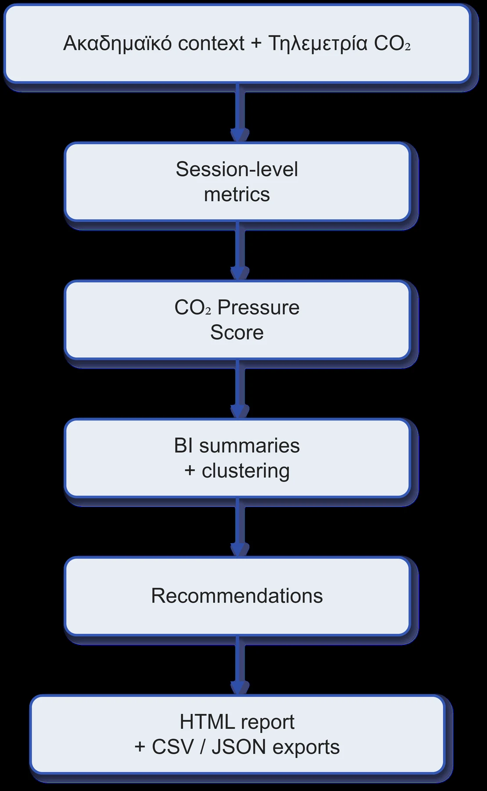
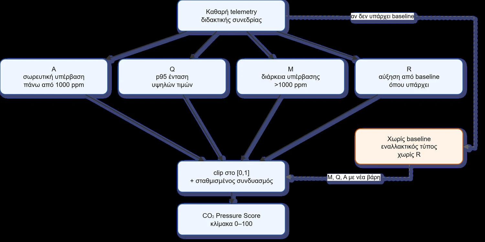
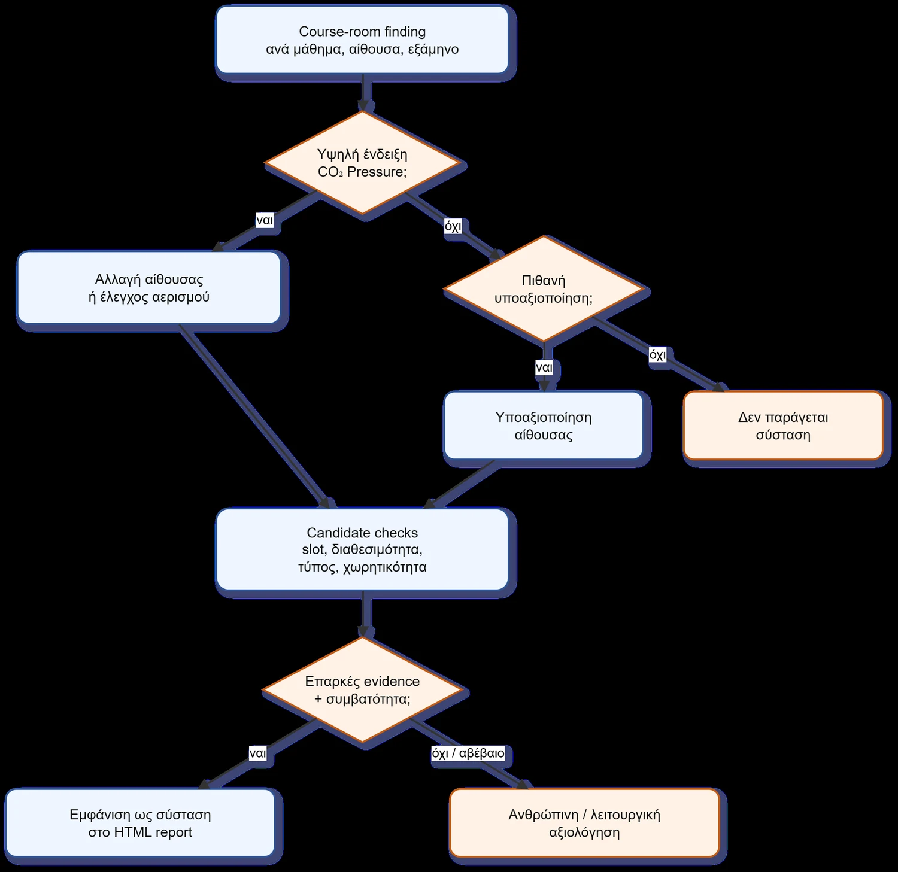
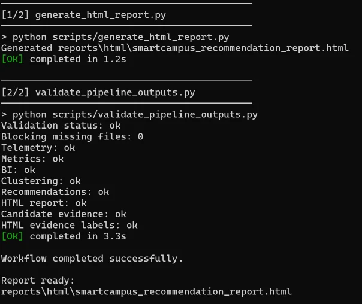

# SmartCampus Omirou

**Indoor Air Quality Analytics · Business Intelligence · Decision Support**

An end-to-end bachelor thesis project from **Harokopio University of Athens (2026)**, combining historical CO₂ telemetry, university timetables and room metadata to produce evidence-aware operational recommendations.

**[🌐 Explore the official university-hosted report](https://smartcampus.hua.gr/reports/smartcampus-recommendations.html)** · **[Architecture](#architecture--pipeline)** · **[Results](#results-gallery)**

*Actual saved output from the thesis. The full interactive HTML report is hosted by Harokopio University at the link above.*

## At a glance

| 11 IAQ sensors | 4,342 telemetry source files | BI & clustering | Human-reviewed recommendations |
|:---:|:---:|:---:|:---:|
| Historical room data | Original project archive | Course, room and semester analysis | Availability, capacity and evidence checks |

## Results gallery

These images are taken from the thesis' **actual generated report**, not mock-ups or a newly executed system.

| Recommendations & CO₂ pressure | Alternative room evidence |
|---|---|
|  |  |
| **Explore & Compare** | **Cross-semester trends** |
|  |  |

### Ventilation review

The report highlights rooms that may warrant further investigation, rather than making automated scheduling or ventilation decisions.

## The problem

An isolated CO₂ reading tells us little about **which class was taking place**, whether the measurement is representative or whether another room merits examination. The project aligns time-stamped sensor observations with academic calendars and teaching sessions, validates measurement coverage, and turns historical data into interpretable BI outputs.

## Architecture & pipeline

  

1. **Academic context:** build validated teaching sessions from calendars, Excel timetables and room metadata.
2. **Telemetry:** ingest/read historical ThingsBoard observations and validate timestamps, sensor mappings and coverage.
3. **Session metrics:** align observations to classes; calculate CO₂ percentiles, duration above the selected threshold, cumulative pressure and optional baseline.
4. **CO₂ Pressure Score:** combine complementary indicators into a relative, comparative metric.
5. **Business intelligence:** aggregate by course, room and semester; use K-means for *descriptive* pressure-profile clustering.
6. **Recommendations:** evaluate alternative rooms using availability, capacity, room type and sufficient supporting data.
7. **Reporting:** export structured CSV/JSON and a bilingual static HTML report; validate pipeline outputs.

### Scoring and recommendation logic

| CO₂ Pressure Score | Evidence-aware recommendation logic |
|---|---|
|  |  |

With a pre-session baseline, the documented score is `100 × (0.30R + 0.25M + 0.25Q + 0.20A)`. The components represent relative baseline rise (R), time over the operational threshold (M), p95 concentration (Q) and cumulative exceedance (A).

### Saved validation evidence

*Recorded validation output from the completed thesis. No code was executed when preparing this showcase.*

## Technology stack

**Python · pandas · NumPy · scikit-learn · ThingsBoard API · CSV/JSON · Excel · Data Validation · K-means · Business Intelligence · HTML Reporting**

## Scientific scope & limitations

- The **CO₂ Pressure Score** is a comparative heuristic, **not** an occupancy counter, attendance measure or health classification.
- The **1,000 ppm** threshold is a project-specific operational analysis threshold, not a universal safety limit.
- **Clustering is descriptive**, not a prediction of health risk.
- Recommendations are **suggestions for human review**, not automatic timetable changes or ventilation controls.
- Historical patterns, telemetry gaps and room requirements affect interpretation.

## Repository scope

This repository is a **documentation and results showcase** based on a completed academic thesis. It contains the overview and selected genuine thesis figures. **The original Python source code and raw telemetry are not included**; they would require separate security, privacy and publication review before any public release.

## Credits

**Antonis Rouseas** — Bachelor Thesis, Department of Informatics & Telematics, Harokopio University of Athens (2026). Supervised by **Dr. Eirini Liotou**.

[Official university-hosted report](https://smartcampus.hua.gr/reports/smartcampus-recommendations.html) · [LinkedIn](https://www.linkedin.com/in/antonis-rouseas/) · [GitHub profile](https://github.com/jerrybananas)