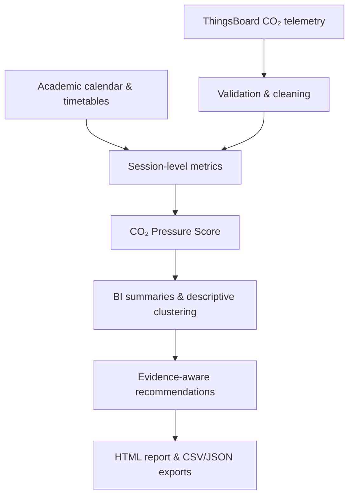

# SmartCampus Omirou

**Indoor Air Quality Analytics · Business Intelligence · Decision Support**

A bachelor's thesis project from the **Department of Informatics & Telematics, Harokopio University of Athens (2026)**. It combines historical indoor-air-quality (IAQ) telemetry with university timetables to help staff explore CO₂ pressure patterns and review potential room or ventilation actions.

**[Explore the university-hosted report](https://smartcampus.hua.gr/reports/smartcampus-recommendations.html)** · **[See the results](#results--screenshots)** · **[How it works](#architecture--data-flow)**

**[Open the published SmartCampus dashboard and results on the university website](https://smartcampus.hua.gr/reports/smartcampus-recommendations.html)**

*The university-hosted report is the official public visual demonstration of this thesis.*

## At a glance

| | |
|---|---|
| **Sources** | Academic calendar, class timetables, room metadata and ThingsBoard sensor telemetry |
| **Scope** | Historical readings from **11 IAQ sensors** |
| **Data** | **4,342 raw telemetry files** retained in the original local project |
| **Analysis** | Data validation, teaching-session metrics, CO₂ Pressure Score, descriptive clustering |
| **Outputs** | Static bilingual HTML report, BI tables and CSV/JSON exports |
| **Purpose** | Evidence-aware *recommendations for human review* — not automatic room scheduling |

## The problem

A high CO₂ reading on its own does not identify which course was running, whether the measurement is representative, or whether a different room might be worth investigating. The system joins sensor readings to **actual teaching sessions**, considers measurement coverage, and builds a traceable, comparative view of rooms and courses.

## Architecture & data flow



The Python pipeline is organised around seven stages:

1. **Academic context:** validate calendars and manually reviewed timetable inputs; map sessions to rooms and time slots.
2. **Sensor telemetry:** retrieve or read historical ThingsBoard data; validate timestamps, values and sensor-to-room mappings.
3. **Session metrics:** align CO₂ observations with scheduled sessions and compute coverage, percentiles, minutes above a threshold, cumulative exposure and optional pre-session baseline.
4. **Pressure Score:** combine complementary CO₂ indicators into a relative 0–100 score for comparison.
5. **BI & clustering:** aggregate course, room and semester summaries; descriptively group similar pressure profiles.
6. **Recommendations:** review alternatives using pressure indicators, availability, capacity, room type and evidence quality.
7. **Reporting & validation:** generate a static HTML report and structured CSV/JSON exports, with validation checks.

## Results & screenshots

### Evidence-aware room recommendations

[View the university-hosted recommendation cards and evidence](https://smartcampus.hua.gr/reports/smartcampus-recommendations.html)

Candidate rooms are presented with availability and supporting telemetry evidence, rather than as automatic assignments.

### Explore & compare

[Explore the published report](https://smartcampus.hua.gr/reports/smartcampus-recommendations.html)

The report supports side-by-side exploration of historical room/course pressure indicators.

### Saved pipeline validation

The thesis documents validation checks for report generation, metrics, clustering and recommendations. No new run was performed for this showcase.

The thesis documents a successful report-generation and validation run. **This repository's preparation did not re-run the pipeline.**

<details>
<summary><strong>Technical deep dive — scoring and recommendation logic</strong></summary>

The **CO₂ Pressure Score** combines duration above the analysis threshold (M), high-end concentration (Q, based on p95), cumulative pressure (A), and — when available — the increase over a pre-session baseline (R). When a baseline is available, the documented formula is:

`Score = 100 × (0.30R + 0.25M + 0.25Q + 0.20A)`

Recommendation decisions include an **evidence guard** so a room with insufficient measurements is not treated as a strong alternative.

</details>

## Technologies & engineering work

**Python**, **pandas**, **NumPy**, **scikit-learn**, **ThingsBoard API**, **CSV/JSON**, **Excel timetable inputs**, static **HTML reporting**, data quality checks and descriptive clustering.

The engineering focus is on **reproducible data-processing stages, validation, traceability, interpretation of time-series metrics and clear presentation of decision support**.

## Scope & limitations

- **CO₂ is not an attendance or people-counting measure.** The pressure score is a comparative heuristic, not a health/safety grade or a direct occupancy estimate.
- **1,000 ppm is an operational analysis threshold in this thesis**, not a universal health or safety limit.
- **Clustering is descriptive.** Groups are not automatically interpreted as risk categories.
- **Room suggestions require human judgement.** They are not live room assignments, automated timetable changes or ventilation control.
- **Historical observations are context-dependent.** Room availability, teaching requirements and sensor coverage affect the interpretation of candidates.

## Repository contents

This initial **portfolio showcase** contains a documented project overview and a direct link to the university-published report. **The source code and raw telemetry are not included in this package.** Selected source modules can be added in a subsequent, separately reviewed release after screening for credentials, private data and institutional restrictions.

```text
smartcampus-omirou-bi/
└── README.md
```

*The documented figures from the thesis can be added to the repository when binary-asset upload is available.*

## Credits

**Antonis Rouseas** — Bachelor thesis (2026), Department of Informatics & Telematics, Harokopio University of Athens. Supervised by **Dr. Eirini Liotou**.

[University-hosted report](https://smartcampus.hua.gr/reports/smartcampus-recommendations.html) · [LinkedIn](https://www.linkedin.com/in/antonis-rouseas/) · [GitHub profile](https://github.com/jerrybananas)